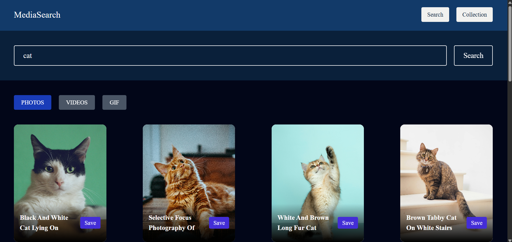
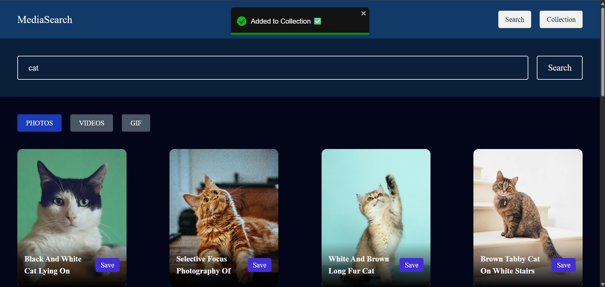
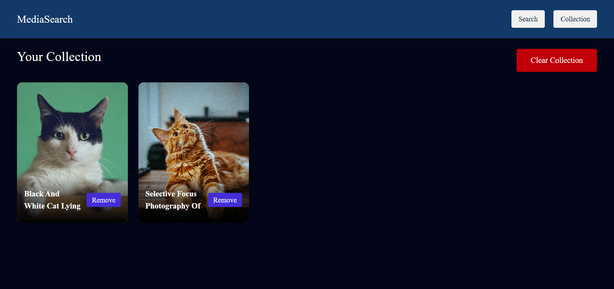

# MediaSearch

A media search app built with React and Redux Toolkit. Search for photos, videos, and GIFs from multiple sources and save them to your personal collection.

#Deploed Link

https://media-search-application-nu.vercel.app/

## Features

- **Search** — Search across Unsplash (photos), Pexels (videos), and Tenor (GIFs) from a single search bar
- **Tabs** — Switch between Photos, Videos, and GIF results
- **Save to Collection** — Save any media item to a local collection for quick access
- **Collection Management** — View, open, or remove saved items from your collection

## Tech Stack

- React 18
- Redux Toolkit + React-Redux
- React Router DOM
- Axios
- Tailwind CSS v4
- Vite

## Getting Started

1. **Install dependencies**

   ```bash
   npm install
   ```

2. **Set up environment variables**

   Create a `.env` file in the project root with the following keys:

   ```
   VITE_UNSPLASH_KEY=your_unsplash_access_key
   VITE_PEXELS_KEY=your_pexels_api_key
   VITE_TENOR_KEY=your_tenor_api_key
   ```

3. **Run the dev server**

   ```bash
   npm run dev
   ```

## API Keys

You'll need free API keys from the following services:

- [Unsplash Developers](https://unsplash.com/developers)
- [Pexels API](https://www.pexels.com/api/)
- [Tenor / Google Cloud](https://developers.google.com/tenor)

## Project Structure

```
src/
├── api/            # API functions (Unsplash, Pexels, Tenor)
├── components/     # Reusable UI components
│   ├── CollectionCard.jsx
│   ├── Navbar.jsx
│   ├── ResultCard.jsx
│   ├── ResultGrid.jsx
│   ├── SearchBar.jsx
│   └── Tabs.jsx
├── pages/          # Route pages
│   ├── HomePage.jsx
│   └── CollectionPage.jsx
├── redux/          # Redux store and slices
│   ├── store.js
│   └── features/
│       ├── searchSlice.js
│       └── collectionSlice.js
├── App.jsx
├── main.jsx
└── index.css
```
##Reference ScreenShorts



